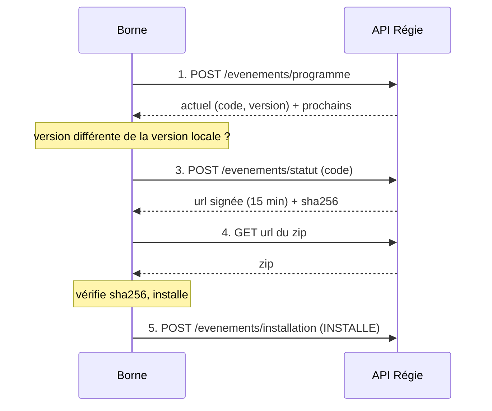

# Mise à jour automatique des événements sur les bornes

Régie Selfizee · API bornes · v1.3 du 25/11/2026

Pour les codes d'événement Régie (`R…`), la borne n'a plus besoin qu'on tape un code : elle demande à la Régie quel
événement faire tourner, le télécharge, le recharge quand il est republié, et signale ce qu'elle a installé.

**v1.2 (18/11/2026, avenant « événement booth »)** : un créneau du programme peut désigner un **événement booth**.
Chaque événement du programme porte un champ `origine` (`"regie"` ou `"booth"`) ; un événement booth a toujours
`version: 0` et `status: "complete"`, et la borne le charge par booth, sans rien télécharger chez la Régie. La route
`installation` accepte `version: 0`. Rien d'autre ne change.

**v1.3 (25/11/2026, avenant « événement booth sur mesure »)** : un événement booth peut porter une `version` de **1 ou
plus**. C'est un événement **sur mesure** : l'exploitant a déposé son zip dans la Régie, et la borne le prend **à la
Régie** (`statut`, puis le zip), exactement comme un événement Régie. `version: 0` garde son sens (la borne le prend
chez booth). Aucun nouveau champ ; voir [Événement booth sur mesure](#événement-booth-sur-mesure).

## Sommaire

- [Le principe](#le-principe)
- [Accès et clé](#accès-et-clé)
- [1. Programme : quel événement faire tourner](#1-programme--quel-événement-faire-tourner)
- [2. Versions de plusieurs codes](#2-versions-de-plusieurs-codes)
- [3. État du zip et lien de téléchargement](#3-état-du-zip-et-lien-de-téléchargement)
- [4. Téléchargement du zip](#4-téléchargement-du-zip)
- [5. Signaler l'installation](#5-signaler-linstallation)
- [Boucle conseillée](#boucle-conseillée)
- [Événement booth dans le programme](#événement-booth-dans-le-programme)
- [Événement booth sur mesure](#événement-booth-sur-mesure)
- [Erreurs](#erreurs)
- [Essais en DEV](#essais-en-dev)

## Le principe

Chaque lieu a un **événement par défaut** (il tourne tout le temps) et des **événements personnalisés** programmés à des
dates (Halloween, une soirée…). Dans la Régie, chaque événement a un code, et un zip figé à chaque publication : la
`version` augmente de 1 à chaque publication.

Depuis la v1.2, un créneau peut aussi désigner un **événement booth** : la Régie ne connaît que son code, saisi par
l'exploitant sans vérification, et le transmet tel quel ; c'est la borne qui le charge par booth, comme un code tapé.
Depuis la v1.3, l'exploitant peut aussi déposer dans la Régie le zip d'un événement booth retouché : la Régie le sert
alors comme un de ses événements (version 1 ou plus).

La borne est rattachée à un lieu dans la Régie. Elle interroge la Régie avec sa clé, sans rien connaître d'autre que son
`borne_id`.



## Accès et clé

- Mêmes règles que l'envoi des ventes et des heartbeats : HTTPS, en-tête `Authorization: Bearer <clé de la borne>`, et
  `borne_id` dans chaque corps JSON (il doit correspondre à la clé).
- Adresse de DEV : `https://regie-selfizee-api.orkessidev.com`. L'adresse de PROD sera communiquée à la mise en
  production. Toutes les routes ci-dessous sont sous `/ingest/v1`.
- La clé de chaque borne est envoyée à part, jamais dans un document qui circule.
- Dates : ISO 8601 avec le décalage de Paris (`2026-11-13T20:00:00.000+01:00`), sauf `publieLe` en UTC.

## 1. Programme : quel événement faire tourner

`POST /ingest/v1/evenements/programme` (nouveau) — au démarrage, puis toutes les **5 minutes**.

Requête :

```json
{ "borne_id": "S513" }
```

Réponse `200` :

```json
{
  "lieu": { "id": 7, "nom": "La Ruche" },
  "maintenant": "2026-11-13T15:00:00.000+01:00",
  "actuel": {
    "code": "RHAL", "origine": "regie", "nom": "Halloween", "parDefaut": false,
    "version": 1, "publieLe": "2026-11-10T09:00:00.000Z", "status": "complete",
    "jusqua": "2026-11-15T00:00:00.000+01:00"
  },
  "prochains": [
    { "code": "RNOE", "origine": "regie", "nom": "Noël", "parDefaut": false, "version": 2, "publieLe": "…",
      "status": "complete", "debut": "2026-11-20T20:00:00.000+01:00", "fin": "2026-11-21T06:00:00.000+01:00" },
    { "code": "AB12", "origine": "booth", "nom": "Soirée privée", "parDefaut": false, "version": 0, "publieLe": null,
      "status": "complete", "debut": "2026-11-22T19:00:00.000+01:00", "fin": "2026-11-23T02:00:00.000+01:00" }
  ]
}
```

| Champ | Sens |
| --- | --- |
| `actuel` | L'événement à faire tourner maintenant. Parmi les événements personnalisés en cours (Régie ou booth), celui qui a commencé le plus tard ; sinon l'événement par défaut (`parDefaut: true`, `nom: null`). Un événement Régie dont le zip n'est pas prêt est sauté. |
| `origine` | `"regie"` : événement de la Régie, à télécharger par `statut` et le zip. `"booth"` avec `version: 0` : code booth, à charger par la borne elle-même (voir [Événement booth dans le programme](#événement-booth-dans-le-programme)). `"booth"` avec une `version` de 1 ou plus : événement booth sur mesure, son zip est à la Régie (voir [Événement booth sur mesure](#événement-booth-sur-mesure)). Toujours présent depuis la v1.2. |
| `actuel.jusqua` | Fin de l'événement ; pour le par défaut, début du prochain événement prêt. `null` : rien de prévu. |
| `actuel: null` | Rien de publié pour ce lieu : garder ce qui tourne. |
| `prochains` | Événements personnalisés qui commencent dans les 14 jours (10 au plus), prêts ou non, pour précharger leur zip. |
| `lieu: null` | La borne n'est rattachée à aucun lieu dans la Régie : rien à faire tourner. |

Valeurs de `status` :

| `status` | Sens |
| --- | --- |
| `complete` | Zip prêt, téléchargeable. Pour un événement booth en `version: 0` : rien à télécharger chez la Régie, le code est à charger. |
| `incomplete` | Jamais publié. |
| `obsolete` | À republier dans la Régie. |
| `unknown` | Code inconnu ou d'un autre lieu. |

## 2. Versions de plusieurs codes

`POST /ingest/v1/evenements/versions` (nouveau) — l'équivalent de `getEventLastUpdate` du booth, pour vérifier d'un coup
les événements gardés sur la borne (50 codes au plus). Facultatif si la borne suit le programme. Pour les codes Régie
et, depuis la v1.3, les événements booth sur mesure programmés sur le lieu de la borne ; un code booth sans zip déposé
répond `unknown`.

Requête :

```json
{ "borne_id": "S513", "codes": ["RHAL", "RNOE", "RZZZ"] }
```

Réponse `200` :

```json
{ "evenements": [
  { "code": "RHAL", "origine": "regie", "nom": "Halloween", "parDefaut": false, "version": 1, "publieLe": "…", "status": "complete" },
  { "code": "RNOE", "origine": "regie", "nom": "Noël", "parDefaut": false, "version": 2, "publieLe": "…", "status": "complete" },
  { "code": "RZZZ", "status": "unknown" }
] }
```

## 3. État du zip et lien de téléchargement

`POST /ingest/v1/evenements/statut` (existante). Pour les codes Régie et, depuis la v1.3, les événements booth sur
mesure (même réponse) ; un code booth sans zip déposé répond `unknown`.

Requête :

```json
{ "borne_id": "S513", "code": "RHAL" }
```

Réponse `200`, zip prêt :

```json
{
  "status": "complete", "code": "RHAL", "version": 1, "publieLe": "…",
  "taille": 18342211, "sha256": "9f2c…",
  "url": "https://<api>/ingest/v1/evenements/RHAL/zip?v=1&exp=…&sig=…",
  "expireLe": "2026-11-13T14:15:00.000Z"
}
```

Autres réponses (toujours en `200`) : `{ "status": "incomplete" }`, `{ "status": "obsolete", "version", "message" }`,
`{ "status": "unknown" }`.

## 4. Téléchargement du zip

`GET` sur l'`url` reçue (existante).

- Sans en-tête d'authentification : l'URL est signée et vaut **15 minutes**.
- `200` `application/zip`, `Content-Length`, `Content-Disposition: attachment; filename="RHAL.zip"`. Reprise d'un
  téléchargement coupé avec l'en-tête `Range`.
- Vérifier le fichier avec `sha256` (ou `taille`) avant de remplacer l'ancien.
- URL fausse, expirée, ou version plus gardée : `404`. Redemander l'état (étape 3).
- Utiliser l'`url` telle quelle : pour un événement booth sur mesure, elle est de la forme
  `…/ingest/v1/evenements/booth/<code>/zip?…` (même fonctionnement).

## 5. Signaler l'installation

`POST /ingest/v1/evenements/installation` (nouveau).

```json
{ "borne_id": "S513", "code": "RHAL", "version": 1, "etat": "INSTALLE", "message": null }
```

Réponse `200` : `{ "ok": true }`

| `etat` | Quand l'envoyer |
| --- | --- |
| `TELECHARGE` | Zip reçu et vérifié (sha256), pas encore installé (préchargement d'un événement à venir). |
| `INSTALLE` | L'événement est installé et tourne (ou est prêt à tourner) sur la borne. |
| `ECHEC` | Téléchargement ou installation raté ; `message` donne la raison (500 caractères au plus). |

La Régie sait ainsi quelle version tourne sur chaque borne.

`version` vaut `0` ou plus : envoyer celle reçue dans le programme. Pour un événement booth chargé chez booth,
`version: 0` ; pour un événement booth sur mesure, la vraie version du zip (1, 2, 3…).

```json
{ "borne_id": "S513", "code": "AB12", "version": 0, "etat": "INSTALLE", "declencheur": "auto" }
{ "borne_id": "S513", "code": "AB12", "version": 0, "etat": "ECHEC", "message": "BadEventCode" }
```

### Automatique ou manuel : le champ `declencheur`

La Régie tient un journal de chaque téléchargement (zip demandé, envoyé, téléchargé, installé, échec) et y note s'il
vient de la mise à jour automatique ou d'un code tapé à la main sur la borne.

- Dans `statut` et `installation`, ajouter le champ facultatif `"declencheur": "auto"` (la borne suit son programme) ou
  `"declencheur": "manuel"` (un code a été tapé).
- Sans ce champ, la Régie le déduit : un code reçu dans le `programme` de la borne dans le dernier quart d'heure est
  « auto », tout autre code est « manuel ». Le dire explicitement est plus sûr.

```json
{ "borne_id": "S513", "code": "RHAL", "declencheur": "auto" }
```

## Boucle conseillée

1. Au démarrage puis toutes les 5 minutes : `programme`.
2. Pour `actuel`, puis pour chaque `prochains` au `status` `complete`, d'origine `regie` ou d'origine `booth` avec une
   `version` de 1 ou plus : si sa `version` diffère de la version gardée sur la borne, demander `statut`, télécharger,
   vérifier `sha256`, puis signaler `TELECHARGE`. Un événement d'origine `booth` en `version: 0` se charge par booth
   (sections suivantes), jamais par `statut`.
3. Si `actuel.code` a changé, basculer sur cet événement ; signaler `INSTALLE`. Entre deux appels, basculer aussi à
   l'heure `jusqua` si le suivant est déjà téléchargé (ou, pour un booth, déjà chargé).
4. En cas d'échec : garder l'ancien zip et l'événement qui tourne, signaler `ECHEC`, réessayer au tour suivant.
5. Sans réseau : continuer avec l'événement installé ; rien ne change tant que la Régie n'a pas répondu.

> **Taper un code reste possible.** Un code saisi à la main sur la borne passe par `statut` comme avant ; il ne doit pas
> être remplacé tant que le programme ne change pas d'`actuel`. À trancher de votre côté : quel choix l'emporte, le code
> tapé ou le programme.

## Événement booth dans le programme

Depuis la v1.2 (avenant du 18/11/2026), l'exploitant peut programmer dans la Régie un **événement booth** sur un lieu, pour
un créneau daté : il saisit le code booth, la Régie ne le vérifie pas et n'a aucun lien avec booth.

- Dans `programme`, le créneau arrive avec `origine: "booth"`, le code tel que saisi (majuscules), `nom` libre ou
  `null`, `version: 0`, `publieLe: null`, `status: "complete"`.
- La borne le charge **par booth**, comme un code tapé, à l'heure prévue (`actuel`, ou `debut` d'un prochain). Elle
  ne doit pas appeler `statut` ni chercher de zip chez la Régie pour ce code (`statut` et `versions` répondent
  `unknown`). Avec une `version` de 1 ou plus, c'est un événement sur mesure : voir la section suivante.
- Elle signale l'installation comme pour un événement Régie, avec `version: 0` : `INSTALLE` quand il tourne, `ECHEC`
  avec le message de booth (par exemple `BadEventCode`) si le code n'existe pas. La Régie affiche cet état à côté du
  créneau, c'est ainsi que l'exploitant voit une faute de frappe.
- À `jusqua`, elle revient à l'événement suivant du programme, en général l'événement par défaut de la Régie.
- Même règle de priorité qu'entre événements Régie : deux créneaux qui se chevauchent, c'est celui qui a commencé le
  plus tard qui tourne. Depuis le 25/11/2026, la Régie refuse deux créneaux booth qui se chevauchent sur un même lieu :
  un booth ne chevauche plus qu'un événement Régie.

Rien ne change pour un créneau d'origine `regie`.

## Événement booth sur mesure

Depuis la v1.3 (avenant du 24/11/2026), l'exploitant peut dire dans la Régie qu'un événement booth est **sur mesure** et
déposer son zip (le zip de booth ou le dossier d'une borne, retouché). La Régie le sert alors aux bornes comme un de ses
événements. La Régie et booth ne se parlent toujours pas.

| `origine` | `version` | La borne prend le zip… |
| --- | --- | --- |
| absent ou `"regie"` | N | à la Régie (`statut`), comme avant |
| `"booth"` | `0` | chez booth (section précédente) |
| `"booth"` | **1 ou plus** | **à la Régie** (`statut`) : événement booth sur mesure |

```json
{ "code": "FTL6", "origine": "booth", "nom": "Mariage Dupont", "parDefaut": false,
  "version": 2, "publieLe": "2026-11-24T10:12:00.000Z", "status": "complete",
  "debut": "2026-11-28T20:00:00.000+01:00", "fin": "2026-11-29T06:00:00.000+01:00" }
```

- **`version`** : le numéro du dernier zip déposé. Chaque dépôt ajoute 1 ; le numéro ne redescend jamais. Si
  l'exploitant retire le zip (case « sur mesure » décochée), le programme renvoie `version: 0` et la borne reprend la
  version de booth. S'il recoche la case, la même version revient, avec le même contenu. Un nouveau dépôt prend le
  numéro suivant.
- **`publieLe`** : date du dépôt (UTC). **`status`** : `complete` quand le zip est prêt ; `obsolete` si son fichier est
  à redéposer, et la borne garde alors ce qui tourne.
- **`statut`** répond exactement comme pour un événement Régie : `status`, `version`, `taille`, `sha256`, `publieLe`,
  `url` signée 15 minutes (de la forme `…/ingest/v1/evenements/booth/<code>/zip?…`, à utiliser telle quelle), reprise
  `Range`. Même règle d'accès : la borne doit être rattachée à un lieu où ce code est programmé.
- **`versions`** donne aussi la version de ces codes.
- **`installation`** : `TELECHARGE`, `INSTALLE`, `ECHEC` avec la vraie version (1, 2, 3…).
- **Contrôles au dépôt** : un `config.json` (à la racine, ou dans un dossier unique : voir ci-dessous), son
  `event.code` égal au code du créneau (comparé en majuscules), 100 Mo au plus. Un zip refusé n'est pas enregistré : rien ne change pour les bornes.
- **Format servi** : toujours celui des zips de la Régie, `config.json` et dossiers de l'événement **à la racine**. Un
  zip téléchargé de booth, qui range tout dans un dossier au nom du code (`D229/config.json`, `D229/Frames/…`), est
  accepté au dépôt et remis à la racine ; `taille` et `sha256` sont ceux du zip servi.
- **Un zip par code** : il vaut pour tous les créneaux de ce code, sur tous les lieux où il est programmé.
- L'événement **reste un événement booth** pour le reste : ses médias restent des médias booth (pas de
  `platform: "regie"`) ; ventes, parcours et heartbeat partent à la Régie avec le code de l'événement, comme avant.

## Erreurs

| HTTP | Corps | Cause et conduite |
| --- | --- | --- |
| `401` | `CLE_INVALIDE` | Clé absente ou fausse. Ne pas réessayer en boucle : vérifier la clé de la borne. |
| `403` | `BORNE_DIFFERENTE` | Le `borne_id` du corps ne correspond pas à la clé. |
| `403` | `BORNE_REFORMEE` | Borne réformée dans la Régie. |
| `400` | `SCHEMA_INVALIDE` + `message` | Corps mal formé (code, version négative, etat…). Le message dit quel champ. |
| `404` | sur le zip | URL expirée ou version plus gardée : redemander `statut`. |
| `5xx` | | Réessayer au tour suivant, en gardant ce qui tourne. |

Chaque refus est enregistré dans la Régie (Journal des bornes, type « Zip de l'événement ») avec sa raison : c'est le
premier endroit à regarder quand un appel échoue.

## Essais en DEV

```bash
# Programme de la borne de test
curl -X POST https://regie-selfizee-api.orkessidev.com/ingest/v1/evenements/programme \
  -H "Authorization: Bearer <clé de la borne>" -H "Content-Type: application/json" \
  -d '{"borne_id":"S513"}'

# Signaler une installation
curl -X POST https://regie-selfizee-api.orkessidev.com/ingest/v1/evenements/installation \
  -H "Authorization: Bearer <clé de la borne>" -H "Content-Type: application/json" \
  -d '{"borne_id":"S513","code":"RHAL","version":1,"etat":"INSTALLE"}'

# Signaler un événement booth chargé (version 0)
curl -X POST https://regie-selfizee-api.orkessidev.com/ingest/v1/evenements/installation \
  -H "Authorization: Bearer <clé de la borne>" -H "Content-Type: application/json" \
  -d '{"borne_id":"S513","code":"AB12","version":0,"etat":"INSTALLE","declencheur":"auto"}'
```

- Toutes ces routes sont en `POST` avec un corps JSON : un `GET` répond `404`.
- La borne de test doit être rattachée au lieu de l'événement dans la Régie (fiche de la borne, affectation). Sinon :
  `lieu: null` et `status: "unknown"`.
- Un événement n'est téléchargeable qu'une fois publié dans la Régie (bouton Publier de sa fiche).
- Pour voir un créneau booth dans le programme : fiche du lieu › Configuration › « + Nouvel événement » › « Événement
  booth », avec un créneau qui couvre le moment de l'essai.
- Pour un événement booth sur mesure : sur ce créneau, menu ⋯ › « Événement sur mesure » › déposer le zip. Le
  programme passe à `version: 1`, et `statut` rend l'URL du zip.

---

Référence côté Régie : `docs/synchronisation-bornes.md`, § 4 quater et § 4 quinquies (dépôt regie-selfizee-api).
