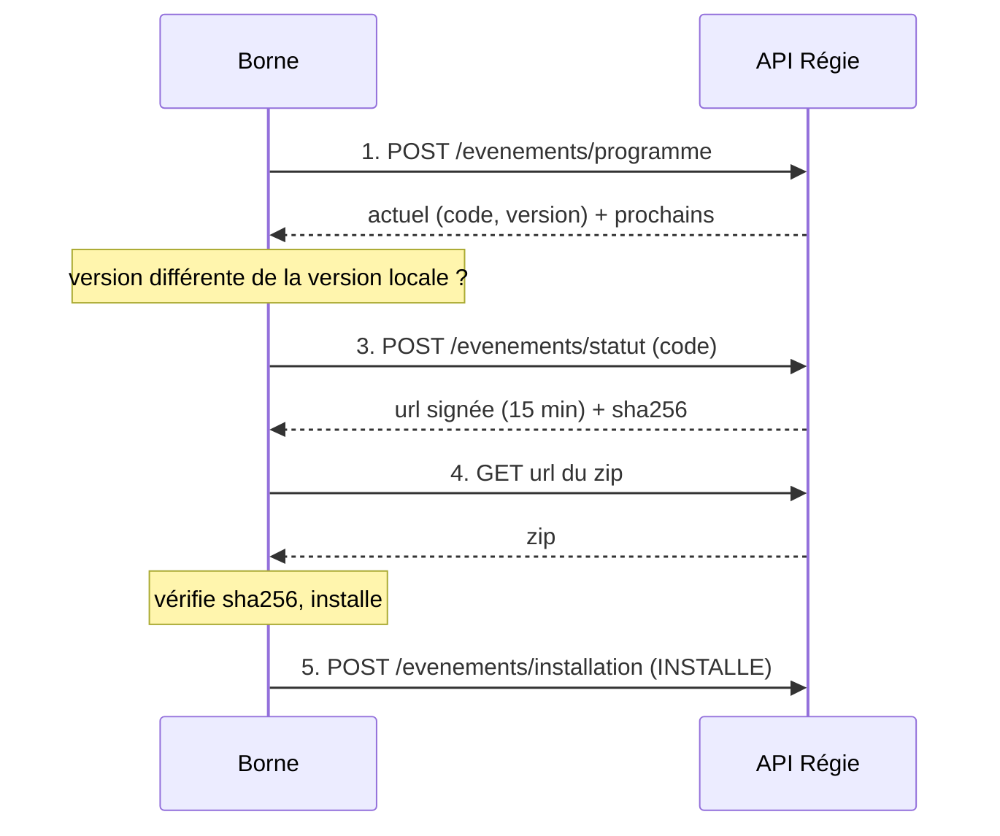

# Mise à jour automatique des événements sur les bornes

Régie Selfizee · API bornes · v1 du 13/11/2026

Pour les codes d'événement Régie (`R…`), la borne n'a plus besoin qu'on tape un code : elle demande à la Régie quel
événement faire tourner, le télécharge, le recharge quand il est republié, et signale ce qu'elle a installé.

## Sommaire

- [Le principe](#le-principe)
- [Accès et clé](#accès-et-clé)
- [1. Programme : quel événement faire tourner](#1-programme--quel-événement-faire-tourner)
- [2. Versions de plusieurs codes](#2-versions-de-plusieurs-codes)
- [3. État du zip et lien de téléchargement](#3-état-du-zip-et-lien-de-téléchargement)
- [4. Téléchargement du zip](#4-téléchargement-du-zip)
- [5. Signaler l'installation](#5-signaler-linstallation)
- [Boucle conseillée](#boucle-conseillée)
- [Erreurs](#erreurs)
- [Essais en DEV](#essais-en-dev)

## Le principe

Chaque lieu a un **événement par défaut** (il tourne tout le temps) et des **événements personnalisés** programmés à des
dates (Halloween, une soirée…). Dans la Régie, chaque événement a un code, et un zip figé à chaque publication : la
`version` augmente de 1 à chaque publication.

La borne est rattachée à un lieu dans la Régie. Elle interroge la Régie avec sa clé, sans rien connaître d'autre que son
`borne_id`.



## Accès et clé

- Mêmes règles que l'envoi des ventes et des heartbeats : HTTPS, en-tête `Authorization: Bearer <clé de la borne>`, et
  `borne_id` dans chaque corps JSON (il doit correspondre à la clé).
- Adresse de DEV : `https://regie-selfizee-api.orkessidev.com`. L'adresse de PROD sera communiquée à la mise en
  production. Toutes les routes ci-dessous sont sous `/ingest/v1`.
- La clé de chaque borne est envoyée à part, jamais dans un document qui circule.
- Dates : ISO 8601 avec le décalage de Paris (`2026-11-13T20:00:00.000+01:00`), sauf `publieLe` en UTC.

## 1. Programme : quel événement faire tourner

`POST /ingest/v1/evenements/programme` (nouveau) — au démarrage, puis toutes les **5 minutes**.

Requête :

```json
{ "borne_id": "S513" }
```

Réponse `200` :

```json
{
  "lieu": { "id": 7, "nom": "La Ruche" },
  "maintenant": "2026-11-13T15:00:00.000+01:00",
  "actuel": {
    "code": "RHAL", "nom": "Halloween", "parDefaut": false,
    "version": 1, "publieLe": "2026-11-10T09:00:00.000Z", "status": "complete",
    "jusqua": "2026-11-15T00:00:00.000+01:00"
  },
  "prochains": [
    { "code": "RNOE", "nom": "Noël", "parDefaut": false, "version": 2, "publieLe": "…",
      "status": "complete", "debut": "2026-11-20T20:00:00.000+01:00", "fin": "2026-11-21T06:00:00.000+01:00" }
  ]
}
```

| Champ | Sens |
| --- | --- |
| `actuel` | L'événement à faire tourner maintenant. Parmi les événements personnalisés en cours, celui qui a commencé le plus tard ; sinon l'événement par défaut (`parDefaut: true`, `nom: null`). Un événement dont le zip n'est pas prêt est sauté. |
| `actuel.jusqua` | Fin de l'événement ; pour le par défaut, début du prochain événement prêt. `null` : rien de prévu. |
| `actuel: null` | Rien de publié pour ce lieu : garder ce qui tourne. |
| `prochains` | Événements personnalisés qui commencent dans les 14 jours (10 au plus), prêts ou non, pour précharger leur zip. |
| `lieu: null` | La borne n'est rattachée à aucun lieu dans la Régie : rien à faire tourner. |

Valeurs de `status` :

| `status` | Sens |
| --- | --- |
| `complete` | Zip prêt, téléchargeable. |
| `incomplete` | Jamais publié. |
| `obsolete` | À republier dans la Régie. |
| `unknown` | Code inconnu ou d'un autre lieu. |

## 2. Versions de plusieurs codes

`POST /ingest/v1/evenements/versions` (nouveau) — l'équivalent de `getEventLastUpdate` du booth, pour vérifier d'un coup
les événements gardés sur la borne (50 codes au plus). Facultatif si la borne suit le programme.

Requête :

```json
{ "borne_id": "S513", "codes": ["RHAL", "RNOE", "RZZZ"] }
```

Réponse `200` :

```json
{ "evenements": [
  { "code": "RHAL", "nom": "Halloween", "parDefaut": false, "version": 1, "publieLe": "…", "status": "complete" },
  { "code": "RNOE", "nom": "Noël", "parDefaut": false, "version": 2, "publieLe": "…", "status": "complete" },
  { "code": "RZZZ", "status": "unknown" }
] }
```

## 3. État du zip et lien de téléchargement

`POST /ingest/v1/evenements/statut` (existante).

Requête :

```json
{ "borne_id": "S513", "code": "RHAL" }
```

Réponse `200`, zip prêt :

```json
{
  "status": "complete", "code": "RHAL", "version": 1, "publieLe": "…",
  "taille": 18342211, "sha256": "9f2c…",
  "url": "https://<api>/ingest/v1/evenements/RHAL/zip?v=1&exp=…&sig=…",
  "expireLe": "2026-11-13T14:15:00.000Z"
}
```

Autres réponses (toujours en `200`) : `{ "status": "incomplete" }`, `{ "status": "obsolete", "version", "message" }`,
`{ "status": "unknown" }`.

## 4. Téléchargement du zip

`GET` sur l'`url` reçue (existante).

- Sans en-tête d'authentification : l'URL est signée et vaut **15 minutes**.
- `200` `application/zip`, `Content-Length`, `Content-Disposition: attachment; filename="RHAL.zip"`. Reprise d'un
  téléchargement coupé avec l'en-tête `Range`.
- Vérifier le fichier avec `sha256` (ou `taille`) avant de remplacer l'ancien.
- URL fausse, expirée, ou version plus gardée : `404`. Redemander l'état (étape 3).

## 5. Signaler l'installation

`POST /ingest/v1/evenements/installation` (nouveau).

```json
{ "borne_id": "S513", "code": "RHAL", "version": 1, "etat": "INSTALLE", "message": null }
```

Réponse `200` : `{ "ok": true }`

| `etat` | Quand l'envoyer |
| --- | --- |
| `TELECHARGE` | Zip reçu et vérifié (sha256), pas encore installé (préchargement d'un événement à venir). |
| `INSTALLE` | L'événement est installé et tourne (ou est prêt à tourner) sur la borne. |
| `ECHEC` | Téléchargement ou installation raté ; `message` donne la raison (500 caractères au plus). |

La Régie sait ainsi quelle version tourne sur chaque borne.

## Boucle conseillée

1. Au démarrage puis toutes les 5 minutes : `programme`.
2. Pour `actuel`, puis pour chaque `prochains` au `status` `complete` : si sa `version` diffère de la version gardée sur
   la borne, demander `statut`, télécharger, vérifier `sha256`, puis signaler `TELECHARGE`.
3. Si `actuel.code` a changé, basculer sur cet événement ; signaler `INSTALLE`. Entre deux appels, basculer aussi à
   l'heure `jusqua` si le suivant est déjà téléchargé.
4. En cas d'échec : garder l'ancien zip et l'événement qui tourne, signaler `ECHEC`, réessayer au tour suivant.
5. Sans réseau : continuer avec l'événement installé ; rien ne change tant que la Régie n'a pas répondu.

> **Taper un code reste possible.** Un code saisi à la main sur la borne passe par `statut` comme avant ; il ne doit pas
> être remplacé tant que le programme ne change pas d'`actuel`. À trancher de votre côté : quel choix l'emporte, le code
> tapé ou le programme.

## Erreurs

| HTTP | Corps | Cause et conduite |
| --- | --- | --- |
| `401` | `CLE_INVALIDE` | Clé absente ou fausse. Ne pas réessayer en boucle : vérifier la clé de la borne. |
| `403` | `BORNE_DIFFERENTE` | Le `borne_id` du corps ne correspond pas à la clé. |
| `403` | `BORNE_REFORMEE` | Borne réformée dans la Régie. |
| `400` | `SCHEMA_INVALIDE` + `message` | Corps mal formé (code, version, etat…). Le message dit quel champ. |
| `404` | sur le zip | URL expirée ou version plus gardée : redemander `statut`. |
| `5xx` | | Réessayer au tour suivant, en gardant ce qui tourne. |

Chaque refus est enregistré dans la Régie (Journal des bornes, type « Zip de l'événement ») avec sa raison : c'est le
premier endroit à regarder quand un appel échoue.

## Essais en DEV

```bash
# Programme de la borne de test
curl -X POST https://regie-selfizee-api.orkessidev.com/ingest/v1/evenements/programme \
  -H "Authorization: Bearer <clé de la borne>" -H "Content-Type: application/json" \
  -d '{"borne_id":"S513"}'

# Signaler une installation
curl -X POST https://regie-selfizee-api.orkessidev.com/ingest/v1/evenements/installation \
  -H "Authorization: Bearer <clé de la borne>" -H "Content-Type: application/json" \
  -d '{"borne_id":"S513","code":"RHAL","version":1,"etat":"INSTALLE"}'
```

- Toutes ces routes sont en `POST` avec un corps JSON : un `GET` répond `404`.
- La borne de test doit être rattachée au lieu de l'événement dans la Régie (fiche de la borne, affectation). Sinon :
  `lieu: null` et `status: "unknown"`.
- Un événement n'est téléchargeable qu'une fois publié dans la Régie (bouton Publier de sa fiche).

---

Référence côté Régie : `docs/synchronisation-bornes.md`, § 4 quater et § 4 quinquies (dépôt regie-selfizee-api).
